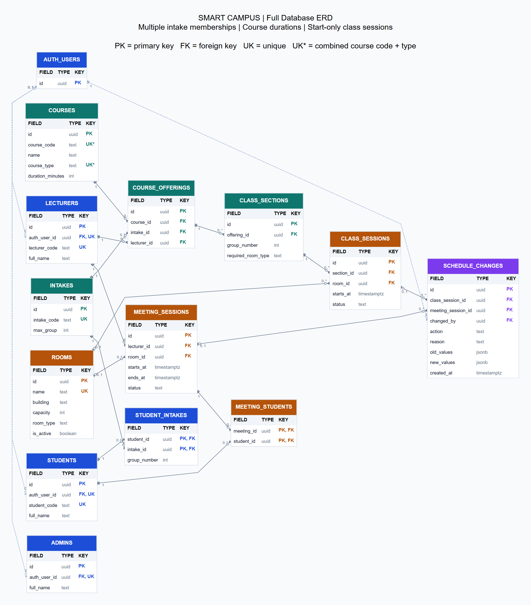
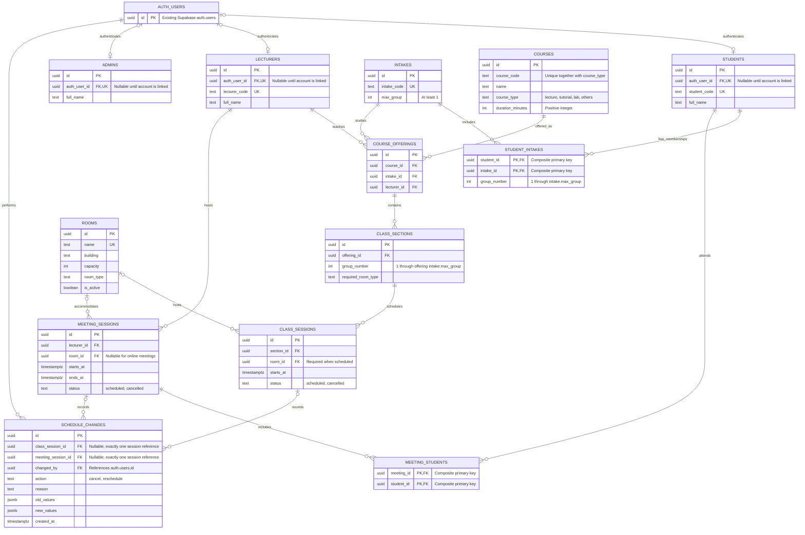

# Smart Campus Database ERD

Students can belong to multiple intakes through `student_intakes`. Each membership has its own group number, limited by that intake's `max_group`; there is no separate group table. Lecturers teach courses offered to particular intakes. Class end times are calculated from their start time and course duration.



[Open scalable SVG](docs/database-erd.svg) | [Open PNG](docs/database-erd.png)

The image shows all tables, fields, key types, and relationship cardinalities. `AUTH_USERS` is Supabase's existing authentication table, shown only with its referenced primary key.

<details>
<summary>Editable diagram source</summary>



</details>

## Rules to implement with the database

- `AUTH_USERS` represents Supabase's existing `auth.users` table; do not create a replacement table.
- `intakes.max_group` is a required positive integer, defaulting to 1. The valid group numbers are consecutive integers from 1 through `max_group`; no group table or group UUID is needed. Hide the group label when `max_group = 1`.
- `students` stores identity only. `student_intakes` links one student to any number of intakes, with composite primary key `(student_id, intake_id)`. It allows one group per student per intake and prevents duplicate memberships.
- `student_intakes.group_number` and `class_sections.group_number` are required positive integers, defaulting to 1. Many memberships can share an intake/group pair; do not make that pair unique.
- Validate each membership's group against its intake's `max_group`. Validate each section's group against the intake reached through its course offering. Use database triggers or protected transactional operations for these cross-table rules, including changes to intake/offering references.
- Reject reductions of `max_group` that would invalidate existing memberships or class sections. Validation must also handle concurrent changes, using a consistent locking strategy across intake updates and membership changes. A row-level `CHECK` alone cannot enforce a range stored in another table.
- This initial model assumes one lecturer per course offering and one group per class section. A student attends all sections matching any of their intake/group memberships; individual course enrolments are not modeled yet. A student joining an intake for selected subjects would require course-level enrolments in a future change.
- Timetable access checks all memberships, so a student can see relevant class sessions and history across multiple intakes. Membership records remain private to that student and admins. Count students through matching memberships for class size; keep meeting attendance tied to the student's identity.
- A course offering represents one course for one intake; enforce uniqueness of `(course_id, intake_id)` for this initial model.
- `courses.course_type` must be one of `lecture`, `tutorial`, `lab`, or `others`; `duration_minutes` must be a required positive integer. Type is stored on the course, so `class_sections.session_type` is removed.
- Each course row represents one teaching type. Enforce composite uniqueness of `(course_code, course_type)`, allowing a subject such as CS101 to have a lecture entry and a separate lab entry with different durations. The course code alone is not unique in this model.
- `auth_user_id` is optional and unique within each role table. An account can have records in multiple role tables if needed.
- `meeting_students` uses `(meeting_id, student_id)` as its combined primary key.
- `class_sessions` stores only `starts_at` as its time field. Derive `ends_at` by joining section -> course offering -> course and calculating `starts_at + duration_minutes * interval '1 minute'`. Expose this calculation through a view/query and use it in every availability check. A generated column cannot directly look up duration in another table.
- Lock course duration once sessions exist for the course. A deliberate duration revision must validate all affected bookings and record the change; otherwise changing duration would silently change existing and historical class end times. Versioned course records can support later curriculum changes.
- Meeting sessions retain both `starts_at` and `ends_at`, with the end later than the start. Store timestamps as `timestamptz` and display them in `Asia/Kuala_Lumpur`.
- Check both class and meeting sessions for lecturer, student, and room overlaps. Cancelled sessions do not block availability. No standalone lecturer-unavailability table is used.
- A scheduled class requires a suitable room with sufficient capacity. A cancelled class may retain its original room.
- Each schedule-change row references exactly one class session or meeting session, enforced by a check constraint. Save session updates and history together in a transaction, with concurrency controls for booking conflicts.
- Enable Row Level Security and define role-appropriate policies when implementing the tables.

Legend: `PK` = primary key, `FK` = foreign key, `UK` = unique key; `||` = exactly one, `o|` = zero or one, `o{` = zero or many.

## Calculating class end times

This query derives an end time without storing it in `class_sessions`. The same expression must be used for scheduling conflict checks.

```sql
select
  cs.*,
  c.course_type,
  c.duration_minutes,
  cs.starts_at + c.duration_minutes * interval '1 minute' as ends_at
from public.class_sessions as cs
join public.class_sections as section on section.id = cs.section_id
join public.course_offerings as offering on offering.id = section.offering_id
join public.courses as c on c.id = offering.course_id;
```

For example, a session starting at 10:00 with `duration_minutes = 90` ends at 11:30.

Implementation references: [PostgreSQL cross-table constraint limitations](https://www.postgresql.org/docs/current/ddl-constraints.html) and [generated-column limitations](https://www.postgresql.org/docs/current/ddl-generated-columns.html).

## Implementation files

For a new project, run [supabase/schema.sql](supabase/schema.sql). For a project using the previous single-intake schema, run [the membership upgrade](supabase/migrations/202611080001_student_intake_memberships.sql) instead; it preserves existing identities and transfers intake/group values into memberships. See [setup instructions](supabase/README.md).

[supabase/seed_students.sql](supabase/seed_students.sql) creates 1,000 unique students and 1,000 initial memberships across the nine planned intakes. Rerunning it preserves additional memberships added later. The database contains 13 application tables plus Supabase's existing authentication table shown here.
